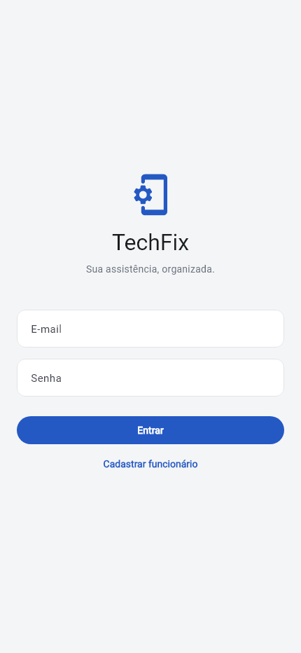
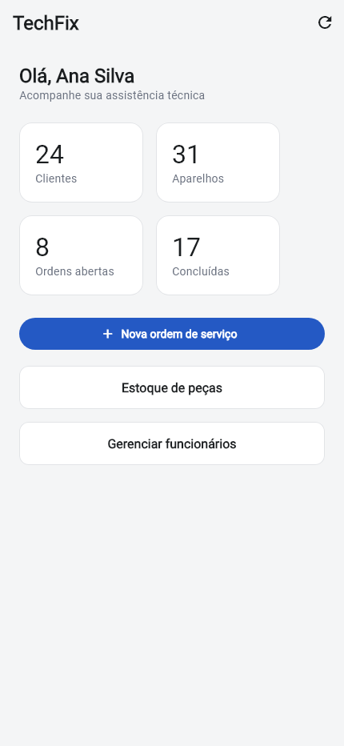
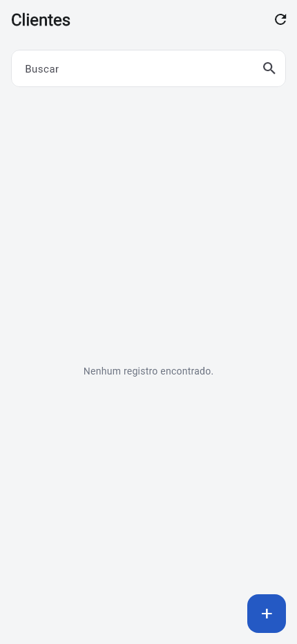
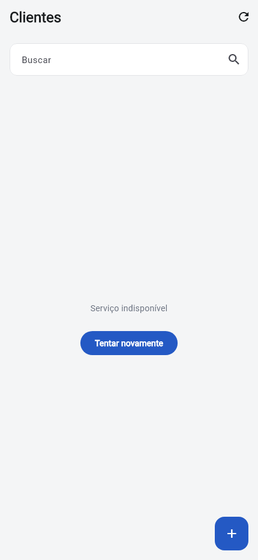

# TechFix — Gestão de assistência técnica

**Aluno:** Everton Kafka

**Base de dados escolhida / integração:** API Laravel (REST), com armazenamento em MySQL.

## Descrição do app

O TechFix é um aplicativo Flutter para gerenciar uma assistência técnica de celulares. Permite cadastrar clientes e aparelhos, acompanhar ordens de serviço, controlar o estoque de peças e consultar indicadores da oficina.

O aplicativo acessa os dados pela API Laravel, mantida em um projeto separado, e utiliza autenticação por tokens do Laravel Sanctum. Funcionários compartilham os registros da oficina; apenas administradores gerenciam os usuários.

## Funcionalidades

- Cadastro, login, restauração de sessão e logout.
- Painel com indicadores e atalhos.
- Cadastro, consulta, edição e exclusão de clientes, aparelhos, ordens e peças.
- Aparelhos com cliente opcional; toda ordem exige um aparelho.
- Status, responsável, diagnóstico, valor e histórico das ordens.
- Edição do perfil e gestão de funcionários por administradores.
- Busca, filtros de ordens, validações e tratamento de falhas de conexão.

## Telas e rotas

| Tela | Rota | Finalidade |
| --- | --- | --- |
| Login | `/login` | Entrar com e-mail e senha. |
| Cadastro | `/register` | Criar uma conta de funcionário. |
| Início | `/home` | Consultar indicadores e atalhos. |
| Clientes | `/clientes` | Gerenciar clientes. |
| Aparelhos | `/aparelhos` | Gerenciar aparelhos. |
| Ordens de serviço | `/ordens` | Consultar, buscar e filtrar ordens. |
| Estoque de peças | `/parts` | Gerenciar peças e quantidades. |
| Funcionários | `/users` | Gerenciar usuários; exclusivo de administradores. |
| Perfil | `/perfil` | Editar os dados do usuário conectado. |
| Novo registro | `/form/:resource` | Cadastrar um registro. |
| Editar registro | `/form/:resource?id=ID` | Editar um registro existente. |
| Detalhes da ordem | `/details/ordens?id=ID` | Consultar a ordem e seu histórico. |

Nos formulários, `:resource` corresponde a `clientes`, `aparelhos`, `ordens`, `parts` ou `users`. As telas internas exigem autenticação. Estas são as rotas do Flutter; consulte os endpoints na [documentação da API](docs/API.md).

## Instruções para rodar

### Pré-requisitos

- Flutter instalado, com Dart compatível com `^3.9.0`.
- Chrome ou Android SDK com emulador/dispositivo.
- API TechFix em execução, com banco configurado e migrations aplicadas no projeto separado da API.

### Iniciar a API

Siga o README do projeto separado da API Laravel para iniciar os serviços. Os comandos abaixo utilizam a API em `http://localhost:8000/api`. Para o navegador, a API deve permitir a origem `http://localhost:8080` no CORS.

### Instalar dependências

Na pasta deste projeto:

```powershell
flutter pub get
```

### Executar no Chrome

```powershell
flutter run -d chrome --web-port=8080 --dart-define=API_BASE_URL=http://localhost:8000/api
```

### Executar no Android

Caso a pasta `android/` ainda não exista, gere a plataforma:

```powershell
flutter create --platforms=android --project-name techfix --org com.techfix .
```

Para desenvolvimento com HTTP, adicione `android:usesCleartextTraffic="true"` ao elemento `application` em `android/app/src/debug/AndroidManifest.xml`. Garanta a permissão `android.permission.INTERNET` no manifesto principal. Use HTTPS em produção.

Inicie o emulador e execute:

```powershell
flutter devices
flutter run -d <ID_DO_EMULADOR> --dart-define=API_BASE_URL=http://10.0.2.2:8000/api
```

Substitua `<ID_DO_EMULADOR>` pelo identificador listado em `flutter devices`. O endereço `10.0.2.2` permite acessar o computador pelo emulador Android. Em um celular físico, use o IP do computador na rede local e permita a porta 8000 no firewall.

### Entrar no aplicativo

Cadastre uma conta ou entre com uma conta existente. Para gerenciar funcionários, utilize uma conta de administrador configurada no projeto da API.

## Prints das telas

As capturas existentes mostram os widgets reais do aplicativo com dados simulados por testes, sem conexão com um banco real durante a captura.

### Login



### Painel inicial



### Clientes — lista vazia



### Falha de conexão



## Verificação e documentação

```powershell
dart analyze lib test
flutter test
```

Para gerar novamente os prints existentes:

```powershell
flutter test test/screenshots_test.dart
```

- [Contrato da API](docs/API.md)
- [Coleção Postman](docs/TechFix.postman_collection.json)
- [Roteiro de demonstração](docs/DEMO.md)
- [Histórico de validação](docs/VALIDATION.md)

O código está em `lib/`, os testes em `test/` e os prints em `docs/screenshots/`. Os exemplos históricos em `docs/original-scaffold/` não fazem parte do aplicativo TechFix.
